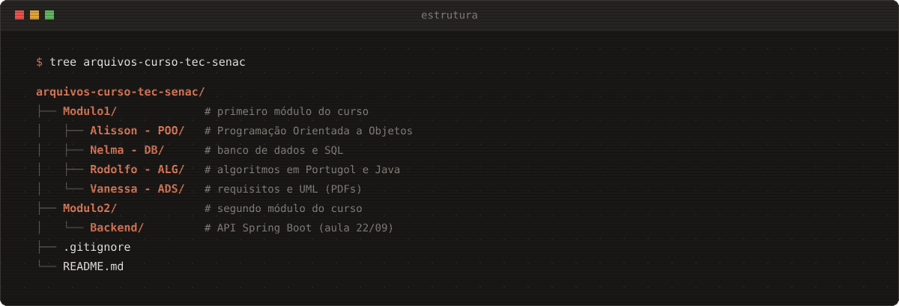

### Módulo 1

**Programação Orientada a Objetos** · Alisson

| Pasta | O que tem |
| --- | --- |
| [POO inicio](Modulo1/Alisson%20-%20POO/Alisson%20-%20POO%20inicio/POO) | Primeira classe: `Calculos`, com as quatro operações |
| [aula1](Modulo1/Alisson%20-%20POO/Alisson%20-%20POO%20aula1/aula1) | Classe `Cliente` com construtores, getters e setters |
| [aula0805](Modulo1/Alisson%20-%20POO/Alisson%20-%20POO%20aula0805/aula0805) | Classe `Pessoa` com entrada de dados pelo `Scanner` |
| [aula1505](Modulo1/Alisson%20-%20POO/Alisson%20-%20POO%20aula1505/aula1505) | Encapsulamento da classe `Pessoa` |
| [aulaHeranca](Modulo1/Alisson%20-%20POO/Alisson%20-%20POO%20aula2905/aulaHeranca) | Herança: `Pessoa` → `Aluno` e `Professor` |
| [polimorfismo](Modulo1/Alisson%20-%20POO/Alisson%20-%20POO%20aula2206/polimorfismo) | Polimorfismo com `Pessoa`, `Cliente`, `Funcionario`, `Gerente` e `Empresa` |
| [sistemaBanco](Modulo1/Alisson%20-%20POO/Avalia%C3%A7%C3%B5es%20-%20Trabalhos/Avalia%C3%A7%C3%A3o%20-%202205/sistemaBanco) | Avaliação de 22/05: `ContaBancaria` com validações (corrigida em 08/06) |
| [esteticaAutomotiva](Modulo1/Alisson%20-%20POO/Avalia%C3%A7%C3%B5es%20-%20Trabalhos/Trabalho%20-%20Encapsulamento%20e%20Heran%C3%A7a/esteticaAutomotiva) | Trabalho de encapsulamento e herança: agendamentos para estética automotiva ([repositório próprio](https://github.com/GabrielCardossso/estetica-automotiva)) |

**Banco de dados** · Nelma

| Arquivo | O que tem |
| --- | --- |
| [aula1404.sql](Modulo1/Nelma%20-%20DB/bancoDeDados/aula1404.sql) | Tabelas de cidade e bairros |
| [aula0505.sql](Modulo1/Nelma%20-%20DB/bancoDeDados/aula0505.sql) | Loja: clientes, funcionários, produtos, pedidos e pagamentos, com chaves estrangeiras |
| [aula0206.sql](Modulo1/Nelma%20-%20DB/bancoDeDados/aula0206.sql) | Continente, país, estado e cidade |
| [atividade2306.sql](Modulo1/Nelma%20-%20DB/bancoDeDados/atividade2306.sql) | Atividade: clientes, funcionários, quartos e reservas |
| [atividadeInnerJoin.sql](Modulo1/Nelma%20-%20DB/bancoDeDados/atividadeInnerJoin.sql) | Atividade de INNER JOIN: clientes, vendedores e produtos |
| [atividadeMercadoLivreGrupo.sql](Modulo1/Nelma%20-%20DB/bancoDeDados/atividadeMercadoLivreGrupo.sql) | Trabalho em grupo: banco no estilo Mercado Livre |
| [sistemaBiblioteca.sql](Modulo1/Nelma%20-%20DB/bancoDeDados/sistemaBiblioteca.sql) | Banco de uma biblioteca: autores, livros e usuários |
| [provaJoins0707.sql](Modulo1/Nelma%20-%20DB/bancoDeDados/provaJoins0707.sql) | Prova de JOINs (07/07) |
| [Respostas atividade Join.txt](Modulo1/Nelma%20-%20DB/atividades-Avalia%C3%A7%C3%B5es-Trabalhos/Respostas%20atividade%20Join.txt) | Diferença entre INNER, LEFT e RIGHT JOIN, com respostas |
| [Inner Join Atividade Respondida.docx](Modulo1/Nelma%20-%20DB/atividades-Avalia%C3%A7%C3%B5es-Trabalhos/Inner%20Join%20Atividade%20Respondida.docx) · [SELECT - JOIN respondido.doc](Modulo1/Nelma%20-%20DB/atividades-Avalia%C3%A7%C3%B5es-Trabalhos/SELECT%20-%20JOIN%20respondido.doc) | Atividades de JOIN respondidas (Word) |

**Algoritmos** · Rodolfo

- Conceitos e condicionais: [conceitosPortugol](Modulo1/Rodolfo%20-%20ALG/Portugol/conceitosPortugol.ALG) · [falsoVerdadeiroAula](Modulo1/Rodolfo%20-%20ALG/Portugol/falsoVerdadeiroAula.ALG) · [maiorNum](Modulo1/Rodolfo%20-%20ALG/Portugol/maiorNum.ALG) · [maiorNumero](Modulo1/Rodolfo%20-%20ALG/Portugol/maiorNumero.ALG) · [maior_Menor](Modulo1/Rodolfo%20-%20ALG/Portugol/maior_Menor.ALG) · [mediaEscolar](Modulo1/Rodolfo%20-%20ALG/Portugol/mediaEscolar.ALG) · [temperatura](Modulo1/Rodolfo%20-%20ALG/Portugol/temperatura.ALG)
- Laços e números: [metodoPara](Modulo1/Rodolfo%20-%20ALG/Portugol/metodoPara.ALG) · [pares](Modulo1/Rodolfo%20-%20ALG/Portugol/pares.ALG) · [impares](Modulo1/Rodolfo%20-%20ALG/Portugol/impares.ALG) · [contadorPares](Modulo1/Rodolfo%20-%20ALG/Portugol/contadorPares.ALG) · [multiplosDe5](Modulo1/Rodolfo%20-%20ALG/Portugol/multiplosDe5.ALG) · [numeroPrimo](Modulo1/Rodolfo%20-%20ALG/Portugol/numeroPrimo.ALG) · [somaDivisores](Modulo1/Rodolfo%20-%20ALG/Portugol/somaDivisores.ALG) · [fibonacci](Modulo1/Rodolfo%20-%20ALG/Portugol/fibonacci.ALG) · [calculoEnergia1](Modulo1/Rodolfo%20-%20ALG/Portugol/calculoEnergia1.ALG) · [calculoEnergia2](Modulo1/Rodolfo%20-%20ALG/Portugol/calculoEnergia2.ALG)
- Recursão: [MdcRecursivo](Modulo1/Rodolfo%20-%20ALG/Portugol/MdcRecursivo.ALG) · [contagemCrescenteRecursiva](Modulo1/Rodolfo%20-%20ALG/Portugol/contagemCrescenteRecursiva.ALG) · [somaDigitosNumeroRecursivo](Modulo1/Rodolfo%20-%20ALG/Portugol/somaDigitosNumeroRecursivo.ALG)
- Busca e ordenação: [buscaLinear](Modulo1/Rodolfo%20-%20ALG/Portugol/buscaLinear.ALG) · [buscaBinaria](Modulo1/Rodolfo%20-%20ALG/Portugol/buscaBinaria.ALG) · [selectionSort](Modulo1/Rodolfo%20-%20ALG/Portugol/selectionSort.ALG) · [insertionSort](Modulo1/Rodolfo%20-%20ALG/Portugol/insertionSort.ALG) · [quickSort](Modulo1/Rodolfo%20-%20ALG/Portugol/quickSort.ALG)
- Matrizes e desenhos: [tabuleiro](Modulo1/Rodolfo%20-%20ALG/Portugol/tabuleiro.ALG) · [tabuleiroMelhorado](Modulo1/Rodolfo%20-%20ALG/Portugol/tabuleiroMelhorado.ALG) · [desenhoArvore](Modulo1/Rodolfo%20-%20ALG/Portugol/desenhoArvore.ALG)
- Pequenos sistemas: [acessoSimples](Modulo1/Rodolfo%20-%20ALG/Portugol/acessoSimples.ALG) · [loginSistema](Modulo1/Rodolfo%20-%20ALG/Portugol/loginSistema.ALG) · [caixaEletronico](Modulo1/Rodolfo%20-%20ALG/Portugol/caixaEletronico.ALG) · [sistemaCadastro](Modulo1/Rodolfo%20-%20ALG/Portugol/sistemaCadastro.ALG) · [relatorioPessoal](Modulo1/Rodolfo%20-%20ALG/Portugol/relatorioPessoal.ALG) · [SISTEMAGERENCIAMENTOPADARIA](Modulo1/Rodolfo%20-%20ALG/Portugol/SISTEMAGERENCIAMENTOPADARIA.ALG) · [testeEmCasaPadaria](Modulo1/Rodolfo%20-%20ALG/Portugol/testeEmCasaPadaria.alg) · [minigameBatalha](Modulo1/Rodolfo%20-%20ALG/Portugol/minigameBatalha.ALG)
- Avaliação de 18/05/2026: [busca binária](Modulo1/Rodolfo%20-%20ALG/Avalia%C3%A7%C3%B5es/AVALIACAO18-05-2026-BUSCABINARIA.ALG) · [energia](Modulo1/Rodolfo%20-%20ALG/Avalia%C3%A7%C3%B5es/AVALIACAO18-05-2026-ENERGIA.ALG) · [Quick Sort](Modulo1/Rodolfo%20-%20ALG/Avalia%C3%A7%C3%B5es/AVALIACAO18-05-2026-QUICKSORT.ALG) · [Torre de Hanói](Modulo1/Rodolfo%20-%20ALG/Avalia%C3%A7%C3%B5es/AVALIACAO18-05-2026-TORREDEHANOI.ALG)
- Java: [QuickSort](Modulo1/Rodolfo%20-%20ALG/Java/QuickSort) · [selectionSort](Modulo1/Rodolfo%20-%20ALG/Java/selectionSort) · [FrequenciaDePalavras](Modulo1/Rodolfo%20-%20ALG/Java/selecionadorPalavras/FrequenciaDePalavras.java)

**Análise e requisitos** · Vanessa

- [aula0804.pdf](Modulo1/Vanessa%20-%20ADS/aula0804.pdf) (jornada do usuário) · [aula1305.pdf](Modulo1/Vanessa%20-%20ADS/aula1305.pdf) (revisão: engenharia de requisitos e UML) · [aula0306.pdf](Modulo1/Vanessa%20-%20ADS/aula0306.pdf) · [atividade0306.pdf](Modulo1/Vanessa%20-%20ADS/atividade0306.pdf)

### Módulo 2

**Back-end** · Alisson: [aula2209](Modulo2/Backend/Alisson/2209/aula2209), API REST em Spring Boot com CRUD de pessoas e endereços.

| Recurso | Endpoints |
| --- | --- |
| `/pessoa` | `GET /listar`, `GET /mostrar/{id}`, `POST /salvar`, `PUT /atualizar/{id}`, `DELETE /deletar/{id}`, `PUT /atribuirEndereco` |
| `/endereco` | `GET /listar`, `GET /mostrar/{id}`, `POST /salvar`, `PUT /atualizar/{id}`, `DELETE /deletar/{id}` |



| Tipo | Como abrir |
| --- | --- |
| `.ALG` (Portugol) | No **VisualG** |
| Projetos Java (pasta com `src/`) | No **VS Code** com a extensão de Java; o `App.java` é o ponto de entrada |
| `.sql` | No **PostgreSQL** (pgAdmin ou `psql`) |
| `.pdf`, `.docx`, `.doc`, `.txt` | Em qualquer leitor de documentos |

### API do Módulo 2

O projeto [`aula2209`](Modulo2/Backend/Alisson/2209/aula2209) usa Java 17 e espera um PostgreSQL local com o banco `inicio` (conexão em [`application.properties`](Modulo2/Backend/Alisson/2209/aula2209/src/main/resources/application.properties)). Com o banco criado:

```bash
cd Modulo2/Backend/Alisson/2209/aula2209
./mvnw spring-boot:run        # no Windows: .\mvnw.cmd spring-boot:run
```

A documentação dos endpoints (springdoc) fica em `http://localhost:8080/swagger-ui.html`.

<a href="https://github.com/GabrielCardossso"></a>
