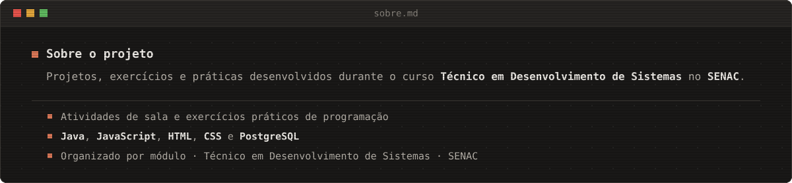

## 🚀 Sobre o repositório

📖 Atividades desenvolvidas em sala de aula  
💻 Exercícios práticos de programação  
🗄️ Estudos envolvendo banco de dados e modelagem  
☕ Projetos utilizando Java, JavaScript, HTML e CSS  
📚 Conteúdos aprendidos durante o curso técnico  

---

## 🛠️ Tecnologias e Ferramentas

  

  
  
  

---

## 📂 Conteúdos

📌 Programação Orientada a Objetos (POO)  
📌 Lógica de Programação  
📌 Banco de Dados  
📌 Desenvolvimento Web  
📌 Estruturas e conceitos de programação 
📌 Levantamento de Requisitos

---

## 🎯 Objetivo

Este repositório tem como objetivo armazenar minha evolução durante o curso técnico, reunindo práticas, exercícios e projetos desenvolvidos ao longo das aulas.

---

